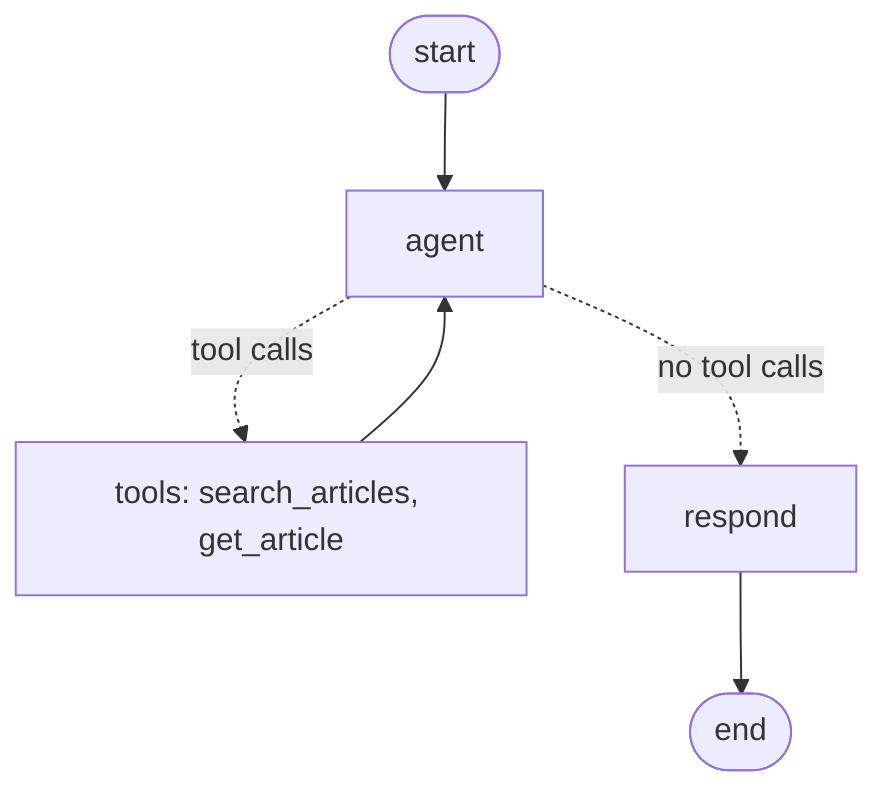

# turkish-legal-assistant

A question answering system over Turkish legislation, built step by step as an AI engineering portfolio project.

Target laws: 4857 Labour Law, 6698 Personal Data Protection Law (KVKK), 6502 Consumer Protection Law, 6098 Turkish Code of Obligations (lease section).

## Status

- Phase 0: FastAPI skeleton with Pydantic models and naive keyword search.
- Phase 1: `ingest.py` downloads the four laws from mevzuat.gov.tr, splits them into one chunk per article (348 articles), and stores title, section path and source URL as metadata in `data/articles.json`.
- Phase 2: an LLM answers with tool calling and structured output, with citations checked against the data (first as hand-written loops for Claude and Gemini, replaced in Phase 4).
- Phase 3: BGE-M3 embeddings (dense + sparse) in an in-memory Qdrant collection, an optional bge-reranker-v2-m3 second stage (`vectors.py`), and a golden dataset of 39 everyday Turkish questions with their expected articles, and `evaluate.py` to score retrievers with Recall@k and MRR.
- Phase 4: a LangGraph agent (`agent.py`) runs the loop for any provider: the model calls `search_articles` / `get_article` until it has enough, then a separate `respond` step returns a `LegalAnswer` JSON. Citations to articles that do not exist are dropped.



## Retrieval results

| Retriever | Recall@1 | Recall@3 | Recall@5 | Recall@10 | MRR |
|-----------|----------|----------|----------|-----------|-----|
| Keyword overlap (baseline) | 0.19 | 0.33 | 0.38 | 0.41 | 0.30 |
| BGE-M3 sparse | 0.33 | 0.42 | 0.45 | 0.54 | 0.42 |
| BGE-M3 hybrid (dense + sparse, RRF) | 0.38 | 0.74 | **0.87** | 0.88 | 0.61 |
| **BGE-M3 dense** (used by `/ask`) | **0.64** | **0.81** | 0.86 | 0.88 | **0.77** |
| Dense top 20 + bge-reranker-v2-m3 (max 512 tokens) | 0.56 | | 0.86 | | 0.72 |
| Dense top 20 + bge-reranker-v2-m3 (max 1024 tokens) | 0.49 | 0.81 | 0.86 | **0.91** | 0.68 |
| Hybrid top 20 + bge-reranker-v2-m3 (max 1024 tokens) | 0.54 | 0.79 | 0.85 | 0.90 | 0.70 |

Findings:
- Equal-weight RRF lets the weak sparse list push good dense hits down, so hybrid ranks worse than dense alone at the top.
- The reranker made ranking worse on this data. It tends to move long, broad articles (e.g. KVKK art. 9) above the specific answer, with low confidence scores (~0.01-0.05), which suggests it is weak on Turkish legal text. Shorter inputs reduce the damage. `/ask` keeps plain dense search.
- With 39 questions, a gap of 0.05 MRR is about two questions, so small differences are not conclusive.

See `CLAUDE.md` for the full roadmap (scraping, LLM, hybrid search, agents, MCP, fine-tuning, evaluation, deployment).

## Quick start

```bash
uv sync
export GEMINI_API_KEY=...  # free key from aistudio.google.com, needed for /ask
# or: export LLM_PROVIDER=claude ANTHROPIC_API_KEY=sk-ant-...
uv run python -m turkish_legal_assistant.ingest  # optional: rebuild data/articles.json
uv run python -m turkish_legal_assistant.vectors  # embed articles (downloads BGE-M3, ~2.3 GB, once)
uv run uvicorn turkish_legal_assistant.main:app --reload
uv run pytest
```

## API

| Method | Path | Description |
|--------|------|-------------|
| GET | `/health` | Health check |
| GET | `/laws` | List laws |
| GET | `/laws/{law_number}/articles/{article_number}` | Get one article |
| POST | `/ask` | Ask a question, e.g. `{"question": "Yıllık izin kaç gündür?", "top_k": 3}` |

Answers and law texts are in Turkish.
