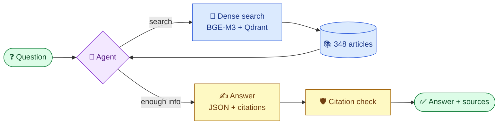

<div align="center">

# ⚖️ Turkish Legal Assistant

**Ask questions about Turkish law in plain Turkish, and get short answers that cite the exact articles.**

[](README.md)
[](README.tr.md)


</div>

---

## 💬 Example

> **Question:** *Ev sahibi oğlu oturacak diye beni evden çıkarabilir mi?*
> (Can my landlord evict me because his son will move in?)
>
> **Answer:** Yes, but only through a court case, and only if his son genuinely needs to live there. If he evicts you this way, he cannot rent the flat to anyone else for 3 years without a valid reason.
>
> 📎 **Sources:** Turkish Code of Obligations, art. 350 · art. 355

Every answer comes from the law text itself, not from the model's memory. Citations to articles that do not exist are removed automatically.

## ✨ What it does

| | |
|---|---|
| 📚 **4 laws, 348 articles** | Labour Law (4857), Personal Data Protection (6698, KVKK), Consumer Protection (6502), Code of Obligations: lease section (6098) |
| 🔎 **Semantic search** | Finds "işveren ücreti ödemiyor" when you ask "patron maaş vermiyor" |
| 🤖 **Agent** | The model searches, reads, searches again if needed, then answers |
| 🔌 **MCP server** | Plug the search into Claude Desktop, Claude Code or any MCP client |
| 🛡️ **Hallucination guard** | Only real, existing articles are shown as sources |
| 🔄 **Any LLM** | Gemini (free tier) or Claude, switched with one setting |

## 🏗️ How it works



This pattern is called **RAG** (Retrieval-Augmented Generation): first *find* the right articles, then let the model *write* the answer from them only.

## 🗺️ Roadmap

| Phase | What | Status |
|:---:|---|:---:|
| 0 | FastAPI skeleton, Pydantic models | ✅ |
| 1 | Scrape mevzuat.gov.tr, split into articles with metadata | ✅ |
| 2 | LLM with tool calling and structured output | ✅ |
| 3 | BGE-M3 embeddings, Qdrant, hybrid search, reranker, evaluation | ✅ |
| 4 | LangGraph agent | ✅ |
| 5 | MCP server | ✅ |
| 6 | Fine-tune a small model with QLoRA, serve with vLLM | 🚧 |
| 7 | RAGAS, LLM-as-a-judge, Langfuse, CI regression tests | ⏳ |
| 8 | Docker Compose, demo UI | ⏳ |

## 📊 Retrieval results

Measured on 39 everyday Turkish questions with known correct articles.

| Retriever | Recall@1 | Recall@5 | MRR |
|---|:---:|:---:|:---:|
| Keyword overlap (baseline) | 0.19 | 0.38 | 0.30 |
| BGE-M3 sparse | 0.33 | 0.45 | 0.42 |
| BGE-M3 hybrid (RRF) | 0.38 | **0.87** | 0.61 |
| 🏆 **BGE-M3 dense** (used) | **0.64** | 0.86 | **0.77** |
| Dense + bge-reranker-v2-m3 | 0.56 | 0.86 | 0.72 |

**Takeaways**
- Dense search beats keywords by a wide margin (MRR 0.77 vs 0.30).
- Hybrid fusion and the reranker did *not* help on this data. The reranker tends to push long, general articles above the specific answer.
- With 39 questions, a 0.05 MRR gap is about two questions, so small differences are not conclusive.

## 🚀 Quick start

```bash
uv sync
export GEMINI_API_KEY=...   # free key from aistudio.google.com
uv run python -m turkish_legal_assistant.vectors   # one-time: embed articles (downloads BGE-M3, ~2.3 GB)
uv run uvicorn turkish_legal_assistant.main:app --reload
```

Open http://localhost:8000/docs and try `POST /ask`.

<details>
<summary>More commands</summary>

```bash
export LLM_PROVIDER=claude ANTHROPIC_API_KEY=...   # use Claude instead of Gemini
uv run python -m turkish_legal_assistant.ingest     # re-download and re-split the laws
uv run python -m turkish_legal_assistant.evaluate   # score the retrievers
uv run pytest                                       # tests (no model or API needed)
```

</details>

## 🌐 API

| Method | Path | Description |
|---|---|---|
| `GET` | `/health` | Health check |
| `GET` | `/laws` | List the laws |
| `GET` | `/laws/{law}/articles/{article}` | One article, e.g. `/laws/4857/articles/53` |
| `POST` | `/ask` | `{"question": "Yıllık izin kaç gündür?"}` |

## 🔌 MCP server

Gives any MCP client three read-only tools: `search_articles`, `get_article`, `list_laws`. The client's own model does the reasoning, so no API key is needed.

**Claude Code**

```bash
claude mcp add turkish-legal -- uv run --directory /path/to/turkish-legal-assistant python -m turkish_legal_assistant.mcp_server
```

**Claude Desktop** (`claude_desktop_config.json`)

```json
{
  "mcpServers": {
    "turkish-legal": {
      "command": "uv",
      "args": ["run", "--directory", "/path/to/turkish-legal-assistant", "python", "-m", "turkish_legal_assistant.mcp_server"]
    }
  }
}
```

## 📁 Project structure

```
src/turkish_legal_assistant/
├── ingest.py        # download and split the laws
├── vectors.py       # BGE-M3 embeddings + Qdrant search
├── agent.py         # LangGraph agent
├── main.py          # FastAPI app
├── mcp_server.py    # MCP server
└── evaluate.py      # Recall@k / MRR
data/
├── articles.json    # 348 articles
└── golden.json      # 39 test questions
```

---

<div align="center">

⚠️ **This project gives general information, not legal advice.** For your own case, consult a lawyer.

Law texts: [mevzuat.gov.tr](https://www.mevzuat.gov.tr)

</div>
