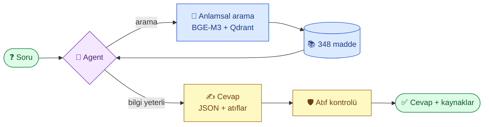

<div align="center">

# ⚖️ Türk Hukuk Asistanı

**Türk mevzuatı hakkında günlük Türkçeyle soru sorun; ilgili maddeyi gösteren kısa cevaplar alın.**

[](README.md)
[](README.tr.md)


[](LICENSE)

</div>

---

## 💬 Örnek

> **Soru:** *Ev sahibi oğlu oturacak diye beni evden çıkarabilir mi?*
>
> **Cevap:** Evet, ama ancak dava açarak ve oğlunun evi kullanma zorunluluğu varsa. Bu sebeple çıkarırsa, haklı bir sebep olmadıkça evi 3 yıl boyunca başkasına kiralayamaz.
>
> 📎 **Kaynaklar:** Türk Borçlar Kanunu, md. 350 · md. 355

Her cevap modelin hafızasından değil, kanun metninin kendisinden gelir. Var olmayan maddelere yapılan atıflar otomatik olarak silinir.

## ✨ Neler yapıyor

| | |
|---|---|
| 📚 **4 kanun, 348 madde** | İş Kanunu (4857), KVKK (6698), Tüketicinin Korunması Hakkında Kanun (6502), Türk Borçlar Kanunu kira hükümleri (6098) |
| 🔎 **Anlamsal arama** | "Patron maaş vermiyor" diye sorduğunuzda "işveren ücreti ödemiyor" diyen maddeyi bulur |
| 🤖 **Agent** | Model arar, okur, gerekirse tekrar arar, sonra cevaplar |
| 🔌 **MCP sunucusu** | Aramayı Claude Desktop, Claude Code ya da herhangi bir MCP istemcisine bağlayın |
| 🛡️ **Halüsinasyon koruması** | Kaynak olarak sadece gerçekten var olan maddeler gösterilir |
| 🔄 **Model bağımsız** | Gemini (ücretsiz katman) ya da Claude, tek ayarla değişir |

## 🏗️ Nasıl çalışıyor



Bu yaklaşımın adı **RAG** (Retrieval-Augmented Generation): önce doğru maddeler *bulunur*, sonra model cevabı *sadece bu maddelere dayanarak* yazar.

## 🗺️ Yol haritası

| Faz | Konu | Durum |
|:---:|---|:---:|
| 0 | FastAPI iskeleti, Pydantic modelleri | ✅ |
| 1 | mevzuat.gov.tr'den kanunları çekmek, madde madde bölmek | ✅ |
| 2 | Tool calling ve structured output ile LLM | ✅ |
| 3 | BGE-M3 embedding, Qdrant, hybrid arama, reranker, ölçüm | ✅ |
| 4 | LangGraph agent | ✅ |
| 5 | MCP sunucusu | ✅ |
| 6 | Küçük bir modeli QLoRA ile eğitmek, vLLM ile sunmak | 🚧 |
| 7 | RAGAS, LLM-as-a-judge, Langfuse, CI'da regresyon testi | ⏳ |
| 8 | Docker Compose, demo arayüzü | ⏳ |

## 📊 Arama sonuçları

Doğru maddesi bilinen 39 günlük Türkçe soru üzerinde ölçüldü.

| Yöntem | Recall@1 | Recall@5 | MRR |
|---|:---:|:---:|:---:|
| Anahtar kelime (başlangıç) | 0.19 | 0.38 | 0.30 |
| BGE-M3 sparse | 0.33 | 0.45 | 0.42 |
| BGE-M3 hybrid (RRF) | 0.38 | **0.87** | 0.61 |
| 🏆 **BGE-M3 dense** (kullanılan) | **0.64** | 0.86 | **0.77** |
| Dense + bge-reranker-v2-m3 | 0.56 | 0.86 | 0.72 |

**Çıkarımlar**
- Anlamsal (dense) arama, anahtar kelime aramasını açık ara geçiyor (MRR 0.77'ye 0.30).
- Hybrid birleştirme ve reranker bu veride işe *yaramadı*. Reranker uzun ve genel maddeleri asıl cevabın önüne geçirme eğiliminde.
- 39 soruda 0.05'lik MRR farkı yaklaşık iki soruya denk geliyor; küçük farklar kesin sonuç sayılmaz.

## 🧪 Testler

**97 test, hepsi yaklaşık bir saniyede geçiyor.** GPU, model indirme ya da API anahtarı gerekmez: LLM yerine senaryolu sahte bir model, BGE-M3 yerine elle yazılmış küçük vektörler kullanılır.

| Alan | Test | Neyi doğruluyor |
|---|:---:|---|
| 📥 Veri çekme | 7 | Kanunlar doğru madde sınırlarından bölünüyor, metadata, 4 kanunun hepsi var, tekrar yok, TBK'da yalnızca kira bölümü var |
| 🔎 Arama | 11 | Dense anlama göre, sparse ortak kelimeye göre sıralıyor, hybrid ikisini birleştiriyor, kanun filtresi, reranker, Türkçe `İ`/`ı` küçültme |
| 📊 Ölçüm | 42 | Recall@k ve MRR hesabı, 39 test sorusunun her biri gerçekten var olan bir maddeyi gösteriyor |
| 🤖 Agent | 8 | Önce arıyor sonra cevaplıyor, olmayan madde modele bildiriliyor, araç döngüsü sınırlı, sağlayıcı ayarları |
| 🌐 API | 13 | Bütün uç noktalar, girdi doğrulama, LLM hatalarının HTTP kodlarına çevrilmesi, Türkçe ret mesajı |
| 🔌 MCP sunucusu | 6 | Araçlar salt okunur, kanun filtresi, hatalı girdi ve olmayan madde araç hatası olarak dönüyor |
| 🧑‍🏫 Fine-tuning verisi | 10 | Soru ve cevap ayrıştırma, verilmeyen maddeye atıf yapan cevaplar atılıyor, üç GPU aşaması dosyalar üzerinden veri aktarıyor |

```bash
uv run pytest
```

## 🚀 Hızlı başlangıç

```bash
uv sync
export GEMINI_API_KEY=...   # aistudio.google.com'dan ücretsiz anahtar
uv run python -m turkish_legal_assistant.vectors   # bir kerelik: maddeleri vektöre çevirir (BGE-M3'ü indirir, ~2.3 GB)
uv run uvicorn turkish_legal_assistant.main:app --reload
```

http://localhost:8000/docs adresini açıp `POST /ask` ile deneyin.

<details>
<summary>Diğer komutlar</summary>

```bash
export LLM_PROVIDER=claude ANTHROPIC_API_KEY=...   # Gemini yerine Claude
uv run python -m turkish_legal_assistant.ingest     # kanunları yeniden indirip böl
uv run python -m turkish_legal_assistant.evaluate   # arama yöntemlerini ölç
uv run pytest                                       # testler (model ya da API gerekmez)
```

</details>

## 🌐 API

| Metot | Yol | Açıklama |
|---|---|---|
| `GET` | `/health` | Sağlık kontrolü |
| `GET` | `/laws` | Kanunları listeler |
| `GET` | `/laws/{law}/articles/{article}` | Tek madde, örn. `/laws/4857/articles/53` |
| `POST` | `/ask` | `{"question": "Yıllık izin kaç gündür?"}` |

## 🔌 MCP sunucusu

Her MCP istemcisine üç salt okunur araç sunar: `search_articles`, `get_article`, `list_laws`. Düşünme işini istemcinin kendi modeli yaptığı için API anahtarı gerekmez.

**Claude Code**

```bash
claude mcp add turkish-legal -- uv run --directory /path/to/turkish-legal-assistant python -m turkish_legal_assistant.mcp_server
```

**Claude Desktop** (`claude_desktop_config.json`)

```json
{
  "mcpServers": {
    "turkish-legal": {
      "command": "uv",
      "args": ["run", "--directory", "/path/to/turkish-legal-assistant", "python", "-m", "turkish_legal_assistant.mcp_server"]
    }
  }
}
```

## 📁 Proje yapısı

```
src/turkish_legal_assistant/
├── ingest.py        # kanunları indir ve böl
├── vectors.py       # BGE-M3 embedding + Qdrant arama
├── agent.py         # LangGraph agent
├── main.py          # FastAPI uygulaması
├── mcp_server.py    # MCP sunucusu
├── evaluate.py      # Recall@k / MRR
└── finetune_data.py # öğretmen modelle eğitim verisi üretimi (Faz 6)
data/
├── articles.json    # 348 madde
└── golden.json      # 39 test sorusu
tests/               # 97 pytest testi, GPU ya da API anahtarı gerekmez
```

---

<div align="center">

⚠️ **Bu proje genel bilgi verir, hukuki tavsiye değildir.** Kendi durumunuz için bir avukata danışın.

Kod: [MIT Lisansı](LICENSE) · Kanun metinleri: [mevzuat.gov.tr](https://www.mevzuat.gov.tr)

</div>
